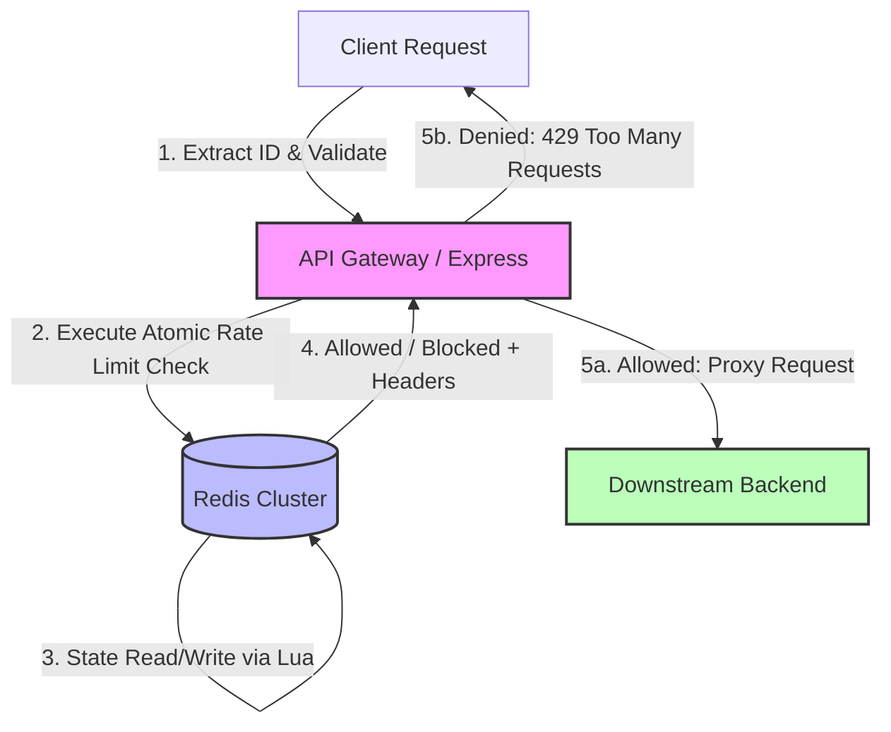

# Distributed API Gateway with Algorithmic Rate Limiting

A high-concurrency, production-grade distributed API Gateway built in Node.js. It acts as a reverse proxy, intercepting and rate-limiting incoming traffic before forwarding it to downstream microservices. Distributed state management is managed atomically using Redis and custom Lua scripts.



---

## 🚀 Key Features

*   **Algorithmic Strategy Pattern**: Swappable rate-limiting backends (Token Bucket and Sliding Window Log) selectable dynamically via environment variables without editing the core middleware.
*   **Atomic State Management**: Rate-limiting checks run entirely inside Redis via custom Lua scripts. This guarantees `EVAL` atomicity, preventing race conditions under heavy concurrent request spikes.
*   **High-Availability Fail-Open Mechanics**: Wraps Redis calls in safe error boundary wrappers. In the event of a Redis outage, the gateway automatically allows traffic to bypass rate-limiting (fail-open) rather than rejecting requests or hanging.
*   **Resilient Observability**: A lightweight `/stats` admin endpoint (JSON & HTML formats) powered by non-blocking Redis `SCAN` iteration. If Redis is offline, it gracefully falls back to displaying local in-memory bypass metrics.
*   **Production-Grade Hardening**:
    *   `enableOfflineQueue: false` configuration to prevent Node.js memory leaks (OOM) during prolonged Redis outages.
    *   Strict payload sanitization (length and character limitations) on client identifiers to block Redis key injection and DoS attacks.
    *   Sanitized HTML responses on `/stats` to prevent Reflected XSS.

---

## 🛠 Tech Stack

*   **Runtime**: Node.js (v20+)
*   **Framework**: Express
*   **Proxying**: `http-proxy-middleware` (v3)
*   **Storage**: Redis (7+) via `ioredis`
*   **Testing**: Custom benchmark harness (simulating concurrent HTTP traffic)

---

## 📊 Performance Benchmarks

Below is a comparison of both rate-limiting strategies executed under identical synthetic loads: **10,000 total requests** sent at **100 concurrent connections**.

| Metric | Token Bucket | Sliding Window Log |
| :--- | :---: | :---: |
| **Throughput (req/s)** | **2,058.88 req/s** | 1,838.24 req/s |
| **Mean Latency** | **48.15 ms** | 53.92 ms |
| **p50 (Median) Latency** | **42.31 ms** | 44.57 ms |
| **p95 Latency** | 92.93 ms | **89.27 ms** |
| **p99 (Tail) Latency** | **118.07 ms** | 168.05 ms |
| **Max Latency** | **290.98 ms** | 1,103.05 ms |
| **Algorithm Complexity** | **O(1)** | O(log N) |
| **Memory Footprint** | **Constant (Hash)** | Dynamic (Sorted Set) |

### Performance Takeaways
*   **Token Bucket** is algorithmically superior for high-throughput nodes. Because state computation is `O(1)` (using a Redis Hash), it achieves **~12% higher throughput** and exhibits significantly tighter tail latencies (`p99` of 118ms vs 168ms).
*   **Sliding Window Log** is highly memory-intensive and computationally heavier (`O(log N)` via Sorted Sets). However, it offers **strict window boundaries**, ensuring a client cannot exceed their limit during overlapping window edges.

---

## ⚙️ Project Architecture & File Structure

```text
├── benchmarks/
│   └── loadtest.js          # HTTP load test runner (ab/wrk equivalent)
├── lib/
│   ├── redis.js             # Hardened ioredis client singleton
│   └── stats.js             # Observability tracker with outage fallback
├── lua/
│   ├── slidingWindowLog.lua # Sorted Set log script with clock-drift guard
│   └── tokenBucket.lua      # Hash bucket script with clock-drift guard
├── middleware/
│   ├── identifyClient.js    # Client extractor (JWT -> API Key -> IP)
│   └── rateLimiter.js       # Strategy-agnostic middleware
├── gateway.js               # API reverse proxy server entrypoint
└── backend.js               # Dummy backend microservice (targets port 4000)
```

---

## 🔧 Installation & Setup

### 1. Run Redis Cache
Ensure Redis is running locally (defaulting to port `6379`). You can start Redis via Docker:
```bash
docker run -d --name rate-limiter-redis -p 6379:6379 redis:alpine
```

### 2. Install Dependencies
```bash
npm install
```

### 3. Run the Backend & Gateway Services
Start the downstream backend microservice (listening on port `4000`):
```bash
node backend.js
```

Start the API Gateway (listening on port `3000`):
```bash
# To run with Token Bucket (Default)
RATE_LIMIT_STRATEGY=token_bucket node gateway.js

# To run with Sliding Window Log
RATE_LIMIT_STRATEGY=sliding_window_log node gateway.js
```

---

## 🧪 Running Load Tests

To execute the custom load testing tool under various loads, specify: `[total_requests] [concurrency] [target_url] [client_api_key]`.

```bash
# Run with 10,000 requests, 100 concurrent workers
node benchmarks/loadtest.js 10000 100 http://localhost:3000/api/products bench-client-key
```

To view stats in the browser during or after the tests, navigate to:
*   JSON stats: `http://localhost:3000/stats`
*   HTML View: `http://localhost:3000/stats?format=html`
